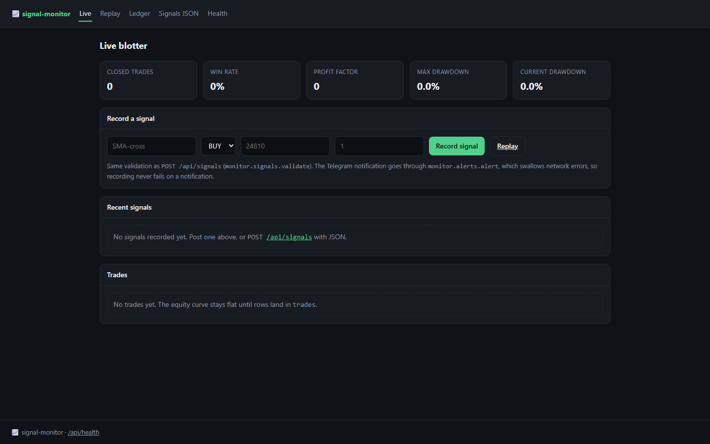
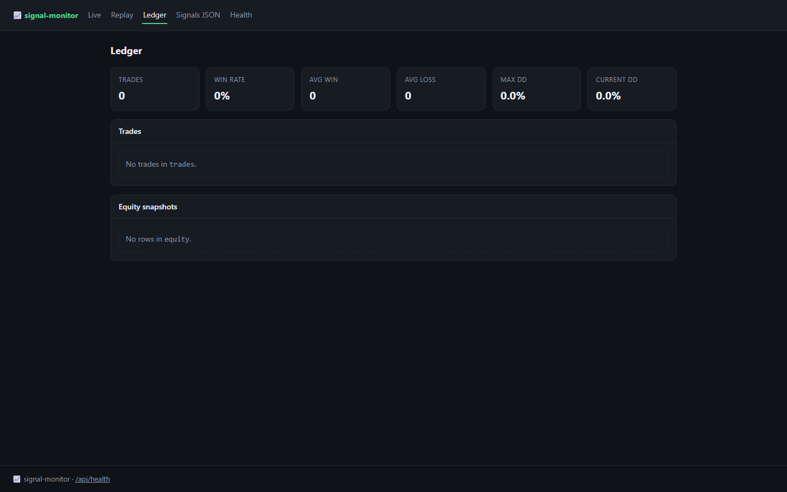
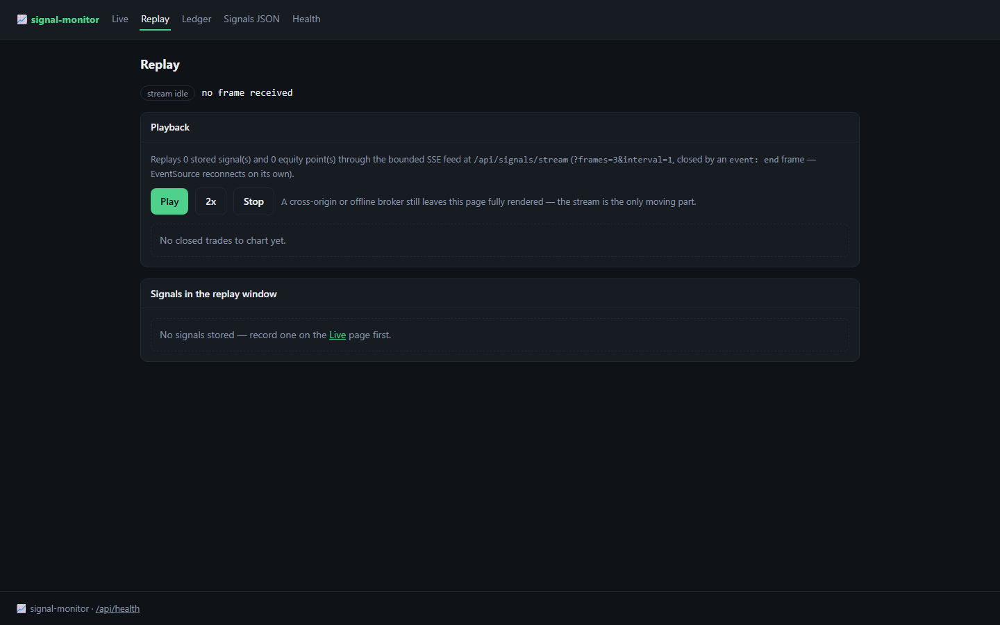

<p align="center">
  
</p>

<h1 align="center">signalwatch</h1>

<p align="center"><b>Track trading signals, positions and equity from one table.</b></p>

<p align="center">
  <a href="#quality-gates"></a> <a href="#quality-gates"></a> <a href="#api"></a> <a href="#requirements"></a> <a href="LICENSE"></a>
</p>

signalwatch ingests signals, opens and closes positions, computes realised and unrealised P&L, and serves an equity curve plus summary statistics — with a replay mode for a historical signal file.

---

**Contents** &nbsp;·&nbsp; [Why](#why-this-exists) &nbsp;·&nbsp; [What it does](#what-it-does) &nbsp;·&nbsp; [Quickstart](#quickstart) &nbsp;·&nbsp; [API](#api) &nbsp;·&nbsp; [Screenshots](#screenshots) &nbsp;·&nbsp; [Measured](#measured-not-estimated) &nbsp;·&nbsp; [Architecture](#architecture) &nbsp;·&nbsp; [Quality gates](#quality-gates) &nbsp;·&nbsp; [Deploy](#deploy) &nbsp;·&nbsp; [Limits](#limits-stated-rather-than-hidden)

## Why this exists

Signal journals live in spreadsheets that drift from reality. Making each signal a row with an explicit open/close transition means the equity curve is derived, not typed, and a replay reproduces the same numbers.

## What it does

| Capability | How it works |
| --- | --- |
| **Signal lifecycle** | Each signal carries its state, entry, exit and size; transitions are validated. |
| **Equity curve** | Cumulative P&L computed from closed positions. |
| **Summary statistics** | Win rate, average win and loss, and totals from the same rows. |
| **Replay** | Feed a historical signal file through the same pipeline. |

## Quickstart

```sh
git clone https://github.com/scar8969/signalwatch.git
cd signalwatch
python -m venv .venv && . .venv/bin/activate   # Windows: .venv\Scripts\activate
pip install -e ".[dev]"
python wsgi.py                                 # http://127.0.0.1:8000
```

The same work from the CLI:

```sh
python -m signal_monitor.cli --help
```

Commands: `signal`, `list`, `equity`, `stats`, `replay`.

A first request:

```sh
curl -s http://127.0.0.1:8000/api/signals | head
```

## Requirements

- Python **3.11+** — CI runs 3.11, 3.12 and 3.13.
- Runtime dependencies: `Flask>=3.0`, `Flask-SQLAlchemy>=3.1`, `SQLAlchemy>=2.0`, `PyYAML>=6.0`.
- No JavaScript build step: every page is server-rendered Jinja.

## API

Every route below is in [`openapi/signalwatch.yaml`](openapi/signalwatch.yaml) and is exercised by the live probe recorded in [`docs/EVIDENCE.md`](docs/EVIDENCE.md).

| Method | Path | What it does |
| --- | --- | --- |
| `GET` | `/api/signals` | list |
| `POST` | `/api/signals` | ingest signal |
| `GET` | `/api/equity` | equity curve |
| `GET` | `/api/stats` | stats |
| `POST` | `/api/replay/start` | replay |

## Screenshots

Captured from the running service with headless Chromium at 1440×900, one image per page, committed under [`docs/assets/screens/`](docs/assets/screens/).

<table>
<tr>
<td width="50%"><br><sub><code>/ledger</code> &middot; 25.4 KB</sub></td>
<td width="50%"><br><sub><code>/replay</code> &middot; 40.5 KB</sub></td>
</tr>
</table>

The other 5 captures — the health, liveness, readiness, metrics and version endpoints — are committed in the same folder rather than shown here.

## Measured, not estimated

These numbers were produced on this checkout by `pytest --cov` and by booting `wsgi.py` and issuing one real GET per documented path. The commands are in [`docs/EVIDENCE.md`](docs/EVIDENCE.md).

| Signal | Value |
| --- | --- |
| Tests | **25 / 25 passed** (2.1 s, exit 0) |
| Line coverage | **61.7%** — 453 of 707 statements |
| Source | 16 files / 1,504 lines |
| Test code | 4 files / 254 lines |
| Documented paths | 4 in the spec, 3 GET |
| Live probe | 13 GET requests to the booted app, **13 answered 200** |
| Median latency | **20.9 ms** (single uncached request, dev server) |
| Slowest / fastest | 2022.5 ms `/api/signals/stream` / 2.5 ms `/version` |
| Bytes served | 18.1 KB across 13 responses |
| Screenshots | 8 captured |

## Architecture

```
signalwatch/
├── src/signal_monitor/
│   ├── http.py                         379  HTTP plumbing for signal_monitor: correlation ids, a
│   ├── _app.py                         201  Flask application for signal-monitor
│   ├── config.py                       171  Environment-driven configuration for signal_monitor
│   ├── observability.py                169  Structured logging and request correlation for signa
│   ├── cli.py                          122  signal-monitor — command line over monitor/{api,pnl,
│   ├── app.py                          119  Application factory for signal_monitor
│   ├── errors.py                       108  Typed application errors and their HTTP mapping for 
│   ├── monitor/api.py                   58  
│   ├── paths.py                         52  Filesystem layout for signal_monitor
│   ├── monitor/pnl.py                   47  
│   ├── models.py                        33  
│   ├── monitor/alerts.py                17  
├── openapi/signalwatch.yaml               the contract of record
├── schema/signalwatch.sql                 the DDL
├── tests/                       the suite that has to stay green
├── docs/EVIDENCE.md             the recorded live route walk
├── Dockerfile                   multi-stage build
└── wsgi.py                      entry point
```

The package keeps one shape across the service: `config.py` reads the environment once, `observability.py` emits structured JSON logs carrying a request id, `errors.py` turns exceptions into a single JSON envelope, `models.py` holds the tables, and the `monitor/` package holds the routes.

## Quality gates

| Gate | Command | Threshold |
| --- | --- | --- |
| Suite | `pytest -q` | all green |
| Coverage | `pytest --cov` | floor set in `pyproject.toml` from the measured value |
| Lint | `ruff check src tests` | zero findings |
| Format | `ruff format --check src tests` | zero reformats |
| Types | `mypy src` | zero errors |
| Security | `bandit -c pyproject.toml -r src` | reviewed skip list, no unreviewed finding |
| Live routes | boot `wsgi.py`, one GET per documented path | no 5xx, no undocumented guard |

CI runs the first six on Python 3.11, 3.12 and 3.13 for every push to `main`, plus a container build. See [`.github/workflows/ci.yml`](.github/workflows/ci.yml).

## Deploy

```sh
docker build -t signalwatch .
docker run --rm -p 8000:8000 --env-file .env.example signalwatch
```

Configuration is environment-only — every variable is documented in [`.env.example`](.env.example), and the service refuses to start with a production secret missing.

## Limits, stated rather than hidden

- No market data feed: prices are whatever the signal records, so P&L is only as good as the input.
- There is no fee or slippage model; the equity curve is the raw arithmetic on the stored prices.

## License

MIT — see [LICENSE](LICENSE).
